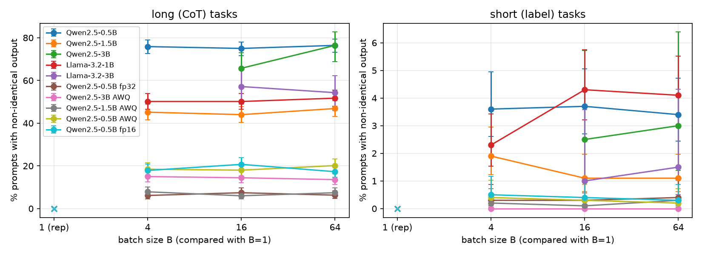
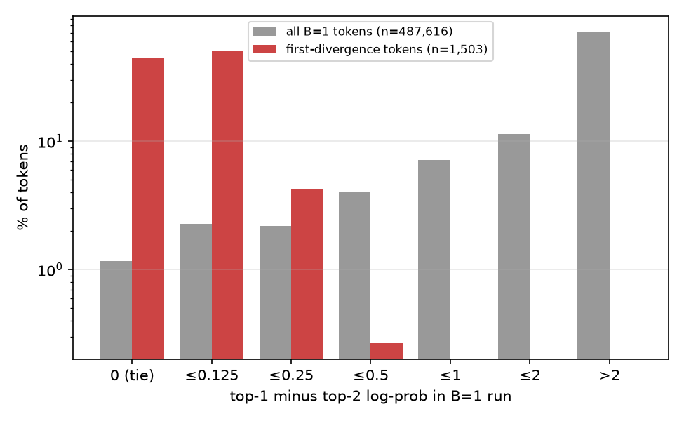
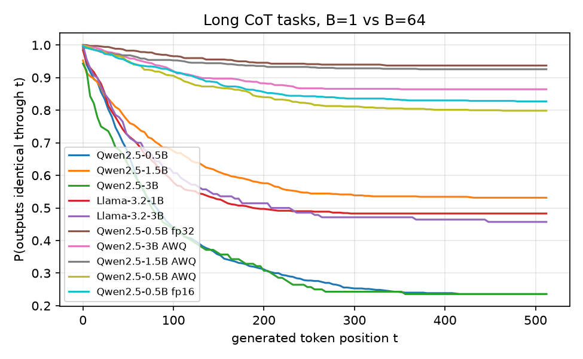
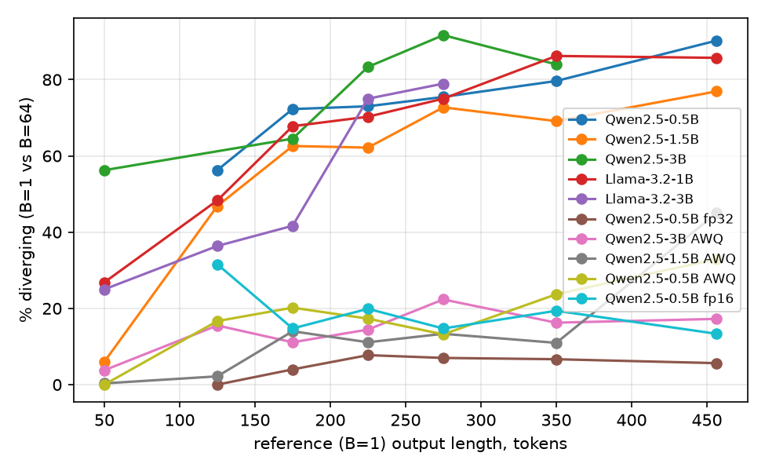
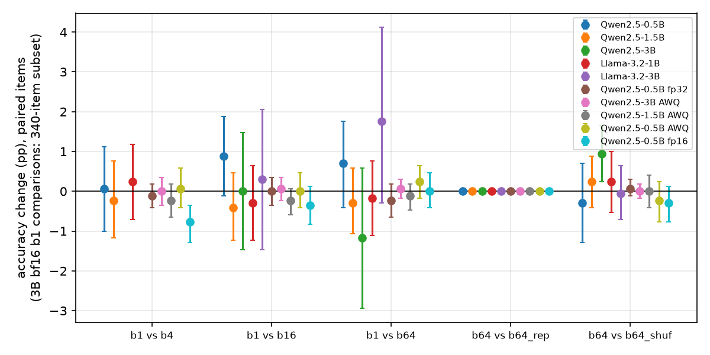

# Batch Size Effects on LLM Inference Quality: Does Batching Change Greedy Outputs?

## 1. Executive Summary

**Question.** With greedy (temperature 0) decoding, does the batch a prompt is processed in change the
model's output? If so, how often, where in the sequence, for which tasks and model sizes, and with
what effect on accuracy?

**Answer.** Yes, and much more often than the hypothesis predicted. We used vLLM 0.32 on byte-identical
prompts and 10 model configurations (5 bf16 models from 0.5B to 3B in two families, plus fp16, fp32
and AWQ variants), with 1,700 prompts each. Moving from sequential decoding (B=1) to any batched
setting (B=4, 16 or 64) changed the exact output of **20–34% of all prompts** for bf16 models,
against the hypothesised 3–5%. For long chain-of-thought (CoT) outputs the figure was **47–76%**.
For short label outputs it was 1–4%. Batch *size* is not the real variable. Keeping B=64 and only
reshuffling which prompts share a batch caused almost as much divergence (40–73% of CoT outputs).
Re-running an identical schedule caused **zero** divergence in all 10 configurations: the engine is
deterministic given the batch, and the only source of variation is which batch a prompt lands in.

**Mechanism.** Every first-divergence token in the bf16 runs was a near-tie. About 45% were *exact*
ties of the top-2 bf16 log-probabilities in the B=1 run, and ≥91% were within one bf16 rounding step
(≤0.125 nats). Only ~1% of all tokens are exact ties, so divergence is ~40× enriched at ties.
Raising numeric precision cuts divergence monotonically on the same Qwen2.5-0.5B weights: bf16 33.5%,
fp16 7.3%, fp32 2.8% of prompts (B=1 vs B=64).

**Practical implications.** Mean accuracy barely moves. Batched minus sequential accuracy was within
±1.8 pp everywhere, and no difference survived Holm correction. Still, 3–5% of all items, and up to
16% of MMLU-CoT items, flip between correct and incorrect. Single-run bf16 evaluations therefore
carry a hidden ±1 pp "batching noise", and per-item results (regression tests, cached answers,
LLM-as-judge pipelines) are not reproducible across serving configurations unless the batch
schedule or the kernels are fixed.

## 2. Research Question & Hypothesis

The hypothesis under test, split into components:

| ID | Claim | Verdict |
|---|---|---|
| H1 | >95% of prompts give identical greedy outputs across batch sizes; only 3–5% diverge | **Refuted** for bf16 (66–80% identical overall, 24–53% on CoT). Holds only for fp32 (97%) and roughly for fp16 or AWQ (92–97%) |
| H1b | The cause is floating-point non-determinism in batched kernels | **Supported**, with a refinement: it is deterministic but batch-*dependent* rounding, and it acts only at near-tied logits |
| H2 | Divergence increases with sequence length | **Supported** (logit coefficient on log length = 1.14, p≈1e-78) |
| H3 | Math/reasoning diverges more than classification | **Refuted as stated.** The gap is fully explained by output length: task kind is n.s. once length is controlled (p=0.58), and per-token divergence hazard is *not* lower for classification. Among CoT tasks, GSM8K math diverges *less* than MMLU-CoT (odds ratio 0.41, p≈5e-31) |
| H4 | Mean accuracy differs by <1 pp, but individual samples flip | **Supported.** Mean \|Δ\| over bf16 models (B=1 vs B=64) = 0.8 pp, none significant; 2.9–5.3% of items flip |
| H5 | Smaller models diverge more | **Not supported.** No monotone trend (Spearman ρ=−0.05, p=0.93, 5 bf16 models). Qwen2.5-3B diverges as much as 0.5B. Precision matters far more than size |

## 3. Background (brief literature context)

No pre-gathered literature, datasets or code were present in this workspace (the resource-finder
stage produced nothing), so this context comes from background knowledge:
- **Thinking Machines Lab, "Defeating Nondeterminism in LLM Inference" (He et al., 2025).** Argues
  that LLM inference non-determinism comes mainly from a lack of *batch invariance*: matmul, RMSNorm
  and attention kernels pick different reduction strategies or tilings depending on batch size, so
  one request's numerics depend on its co-scheduled requests. Atomics-based run-to-run nondeterminism
  is not the main cause. They provide batch-invariant kernels for vLLM.
- **Yuan et al. (2025), "Give Me FP32 or Give Me Death? Challenges and Solutions for Reproducible
  Reasoning".** Report that GPU count, batch size and dtype change greedy outputs and accuracy of
  reasoning models, and that higher precision (fp32) largely restores reproducibility.
- **Atil et al. (2024), "LLM Stability: A detailed analysis with some surprises".** Shows that
  "deterministic" API settings still give varying outputs.

Our study adds a controlled per-prompt decomposition on open models: (i) batch size versus batch
composition versus run-to-run repeat; (ii) task type versus output length; (iii) a token-level
mechanism (margin at the divergence point); (iv) a precision ladder on fixed weights; (v) model size
within a fixed dtype.

## 4. Methodology

### 4.1 Models (all local, via vLLM; no API models, because the question concerns the inference engine itself)

| Tag | Model | Weights / activation dtype |
|---|---|---|
| q05, q15, q3 | Qwen/Qwen2.5-{0.5B,1.5B,3B}-Instruct | bf16 |
| l1b, l3b | Llama-3.2-{1B,3B}-Instruct (unsloth mirror) | bf16 |
| q05f16 | Qwen2.5-0.5B-Instruct | fp16 (same weights, cast) |
| q05f32 | Qwen2.5-0.5B-Instruct | fp32 (same weights, cast) |
| q05awq, q15awq, q3awq | Qwen/Qwen2.5-{0.5B,1.5B,3B}-Instruct-AWQ | int4 weights, fp16 activations |

The planned Qwen2.5-7B bf16 run needs a ≥19 GB GPU slice, and it never got one on the shared GPUs
during the session (see §6).

### 4.2 Data (1,700 items; `datasets/processed/items.jsonl`, seed 42)

| Task | Source | n | Output type | max_tokens |
|---|---|---|---|---|
| gsm8k | openai/gsm8k test | 400 | CoT + "The answer is N" | 512 |
| mmlu_cot | cais/mmlu test | 300 | CoT + "The answer is X" | 512 |
| mmlu_direct | cais/mmlu test (disjoint questions) | 400 | letter only | 8 |
| agnews | fancyzhx/ag_news test | 300 | topic label | 8 |
| sst2 | stanfordnlp/sst2 validation | 300 | positive/negative | 8 |

MMLU appears both with CoT (long) and as a direct letter answer (short). This lets us separate
*task* from *output length*. Prompts are chat-templated with a task-specific system prompt (see
`src/generate.py`, `SYSTEM`).

### 4.3 Conditions (one vLLM engine per model, all conditions run in the same engine)

Prompts are put in a fixed, task-mixed random order (seed 0), then submitted as static chunks of B
(`llm.generate(chunk)`), so exactly ≤B sequences are co-scheduled.

| Condition | B | Order | Purpose |
|---|---|---|---|
| b1 | 1 | A | sequential reference |
| b4, b16, b64 | 4/16/64 | A | batch-size sweep |
| b64_rep | 64 | A | identical schedule again: run-to-run noise floor |
| b64_shuf | 64 | B (seed 1) | same B, different batch-mates |
| b1_rep | 1 | A, every 5th item (n=340) | determinism of the reference |

Engine settings: vLLM 0.32.0 (V1 engine, in-process), `enforce_eager=True`, chunked prefill
(`max_num_batched_tokens=1024`), `max_num_seqs=64`, **prefix caching disabled**, `max_model_len=2048`,
`temperature=0`, `logprobs=2` (top-2 log-probs recorded for every generated token), seed 1234.
For the 3B bf16 models, time limits on the shared GPUs forced two changes: b1 and b1_rep ran on the
340-item subset (every 5th item), and b4 was dropped.

### 4.4 Metrics and statistics
- **Divergence** = generated token-id sequences not identical. Also recorded: first divergence index
  and whether the extracted answer changed.
- **Margin at divergence** = top-1 minus top-2 log-prob in the *reference* run at the first
  differing position.
- **Accuracy** by rule-based answer extraction (`src/analyze.py: extract`). Paired comparison:
  exact McNemar (binomial) test, Holm-corrected over the 28 primary (model × B∈{4,16,64} vs B=1)
  tests, plus a 2,000-sample paired bootstrap 95% CI on Δaccuracy.
- Wilson 95% CIs for divergence proportions. Logistic regression `div ~ log(len) + task + model` for
  H2/H3. Per-token hazard = divergences per 1,000 identical tokens at risk. Spearman ρ for model size
  (H5).

### 4.5 Hardware / reproducibility
4× RTX A6000 (48 GB), heavily shared with other users. Each job ran in a 3.4–8.8 GB slice. Python
3.12.12, vLLM 0.32.0, torch 2.13.0+cu130, transformers 5.19, driver 595.58. Total generation was
~19 GPU-hours of wall time across 10 configurations (~10.5k generations each); see
`results/gen/*/timing.jsonl`. Raw outputs, including token ids and per-token margins, are in
`results/gen/<model>/<cond>.jsonl`.

## 5. Results

### 5.1 How often do outputs change? (H1)

Percentage of prompts whose greedy output is **not** token-identical (Wilson 95% CIs in
`results/summary_divergence_kind.csv`). Long = gsm8k + mmlu_cot (n=700); short = 3 label tasks
(n=1000); 3B bf16 b1 comparisons use the 140/200-item subsets.

| Model | dtype | B1 vs B4 long / short | B1 vs B16 long / short | **B1 vs B64 long / short** | **B64 vs B64-shuffled** long / short | B64 vs B64 repeat | B1 vs B1 repeat |
|---|---|---|---|---|---|---|---|
| Qwen2.5-0.5B | bf16 | 75.9 / 3.6 | 75.0 / 3.7 | **76.4 / 3.4** | 72.7 / 1.3 | 0 / 0 | 0 / 0 |
| Qwen2.5-1.5B | bf16 | 45.1 / 1.9 | 44.0 / 1.1 | **46.9 / 1.1** | 40.0 / 0.3 | 0 / 0 | 0 / 0 |
| Qwen2.5-3B | bf16 | – | 65.7 / 2.5 | **76.4 / 3.0** | 63.7 / 0.0 | 0 / 0 | – |
| Llama-3.2-1B | bf16 | 50.1 / 2.3 | 50.1 / 4.3 | **51.7 / 4.1** | 45.3 / 0.4 | 0 / 0 | 0 / 0 |
| Llama-3.2-3B | bf16 | – | 57.1 / 1.0 | **54.3 / 1.5** | 47.0 / 0.4 | 0 / 0 | 0 / 0 |
| Qwen2.5-0.5B | fp16 | 17.9 / 0.5 | 20.7 / 0.4 | **17.3 / 0.3** | 16.1 / 0.0 | 0 / 0 | 0 / 0 |
| Qwen2.5-0.5B | **fp32** | 6.1 / 0.3 | 7.4 / 0.3 | **6.3 / 0.4** | 4.9 / 0.0 | 0 / 0 | 0 / 0 |
| Qwen2.5-0.5B | AWQ | 18.4 / 0.4 | 18.0 / 0.3 | **20.1 / 0.2** | 19.9 / 0.4 | 0 / 0 | – |
| Qwen2.5-1.5B | AWQ | 7.9 / 0.2 | 6.0 / 0.1 | **7.4 / 0.3** | 8.7 / 0.1 | 0 / 0 | 0 / 0 |
| Qwen2.5-3B | AWQ | 15.0 / 0.0 | 14.4 / 0.0 | **13.6 / 0.0** | 13.9 / 0.0 | 0 / 0 | 0 / 0 |

Pooled over all 1,700 prompts (B=1 vs B=64), the share of prompts with a different output was:
Qwen-0.5B 33.5% [31.3, 35.7], Qwen-1.5B 19.9%, Qwen-3B 33.2% (n=340), Llama-1B 23.7%, Llama-3B
23.2% (n=340), fp16 7.3%, fp32 2.8% [2.1, 3.7], AWQ 3.2–8.4%. The *extracted answer* changed for
5–12.5% of prompts (bf16) and 0.5–3.4% (other dtypes).

Key observations:
1. **No dose-response in B.** B=4 already gives the full effect, and B=64 adds nothing. What matters
   is *whether* the numerics change, not by how much the batch grows.
2. **Batch composition is as important as batch size.** Reshuffling batch-mates at fixed B=64 gives
   83–100% of the B1-vs-B64 divergence.
3. **The engine is perfectly deterministic for a fixed schedule.** All 18 repeat comparisons (10 × b64_rep,
   8 × b1_rep) showed 0 divergent prompts out of 19,720. The variation is batch-*dependence*, not
   randomness.

### 5.2 Where do divergences start? Mechanism (H1b)

| Model | % of all B=1 tokens that are exact top-2 ties | % of first-divergence tokens that are exact ties | % of divergences with margin ≤0.125 | median margin at divergence |
|---|---|---|---|---|
| Qwen2.5-0.5B bf16 | 1.02 | 43.2 | 93.9 | 0.125 |
| Qwen2.5-1.5B bf16 | 0.93 | 46.9 | 96.2 | 0.125 |
| Qwen2.5-3B bf16 | 1.38 | 43.4 | 91.2 | 0.125 |
| Llama-3.2-1B bf16 | 1.55 | 45.2 | 97.8 | 0.125 |
| Llama-3.2-3B bf16 | 1.52 | 46.8 | 100 | 0.125 |
| Qwen2.5-0.5B fp16 | 0.14 | 46.8 | 100 | 0.016 |
| Qwen2.5-0.5B fp32 | 0.00 | 0 | 100 | 0.0014 |
| Qwen2.5 AWQ (0.5/1.5/3B) | 0.12–0.14 | 45–60 | 100 | 0.000–0.016 |

In bf16, logits are stored with an 8-bit mantissa, so log-probs near the top come in steps of 0.0625
to 0.125 nats. About 1% of all tokens are exact ties, and about 3–5% are within one step. The
batch-dependent reduction order perturbs the logits by roughly one rounding step, which is enough to
flip the argmax *only* at these near-ties. Margins at divergence never exceeded 0.375 nats; for
fp16/fp32 they never exceeded 0.047 nats. Precision ladder on identical Qwen2.5-0.5B weights
(prompts diverging, B1 vs B64): **bf16 33.5% → fp16 7.3% → fp32 2.8%**. AWQ models compute in fp16
and sit at the fp16 level (3–8%), i.e. well below their bf16 counterparts. Activation precision, not
quantisation, is the dominant factor.

Once two runs diverge at one near-tie, the continuations differ and are not "re-synchronised". The
median first divergence comes ~45–57 tokens into a CoT for bf16 (~60–110 for fp16/fp32/AWQ), at ~20–40% of
the output length. For bf16 short-label tasks 44–100% of divergences hit the very first generated token,
which is decided by the prefill pass.

### 5.3 Length versus task type (H2, H3)

- **Length (H2).** Divergence rises steeply with output length. For bf16 models it goes from 6–56%
  for ~50-token CoTs to 77–90% for >400-token CoTs (bins with ≥10 items). In logistic regression on CoT items (B1 vs B64,
  all models) the log(length) coefficient is +1.14 (p≈1e-78). Across all tasks it is +0.95
  (p≈3e-67).
- **Task (H3).** Classification looks much more stable (1–4% vs 47–76%), but that is because its
  outputs are 1–3 tokens long. With log length in the model, *short-label vs CoT* has coefficient
  −0.14, p=0.58 (n.s.). The per-token hazard (divergences per 1,000 tokens at risk, B1 vs B64) is
  *not* lower for label tasks. For bf16 models it is 3.7–5.8 for GSM8K, 5.7–12.9 for MMLU-CoT,
  5.8–36.6 for MMLU-direct, and 0–31 for AG News/SST-2 (`results/summary_hazard.csv`). Uncertain
  multiple-choice first tokens are especially tie-prone. Within CoT tasks, **math (GSM8K) diverges
  less than MMLU-CoT** at equal length (odds ratio 0.41, p≈5e-31). One plausible reading: arithmetic
  steps are more peaked (fewer near-ties) than free-text explanations of answer options.

### 5.4 Accuracy impact (H4)

| Model | Acc B=1 | Acc B=64 | Δ (pp) [95% CI] | items flipped (R→W / W→R) | flip % | McNemar p (Holm) |
|---|---|---|---|---|---|---|
| Qwen2.5-0.5B bf16 | 56.18 | 56.88 | +0.71 [−0.41, +1.76] | 39 / 51 | 5.3 | 0.25 (1.0) |
| Qwen2.5-1.5B bf16 | 70.88 | 70.59 | −0.29 [−1.06, +0.59] | 29 / 24 | 3.1 | 0.58 (1.0) |
| Qwen2.5-3B bf16 (n=340) | 72.94 | 71.76 | −1.18 [−2.94, +0.59] | 7 / 3 | 2.9 | 0.34 (1.0) |
| Llama-3.2-1B bf16 | 50.12 | 49.94 | −0.18 [−1.12, +0.76] | 35 / 32 | 3.9 | 0.81 (1.0) |
| Llama-3.2-3B bf16 (n=340) | 67.65 | 69.41 | +1.76 [−0.29, +4.12] | 4 / 10 | 4.1 | 0.18 (1.0) |
| Qwen2.5-0.5B fp16 | 56.82 | 56.82 | 0.00 [−0.41, +0.47] | 7 / 7 | 0.8 | 1.0 (1.0) |
| Qwen2.5-0.5B fp32 | 56.35 | 56.12 | −0.24 [−0.65, +0.18] | 8 / 4 | 0.7 | 0.39 (1.0) |
| Qwen2.5-0.5B AWQ | 45.00 | 45.24 | +0.24 [−0.18, +0.65] | 4 / 8 | 0.7 | 0.39 (1.0) |
| Qwen2.5-1.5B AWQ | 67.47 | 67.35 | −0.12 [−0.47, +0.18] | 5 / 3 | 0.5 | 0.73 (1.0) |
| Qwen2.5-3B AWQ | 74.53 | 74.59 | +0.06 [−0.18, +0.29] | 2 / 3 | 0.3 | 1.0 (1.0) |

Accuracy is micro-averaged over all 1,700 items (the 340-item subset for 3B bf16). None of the 28
primary B-vs-B1 tests is significant after Holm correction. The smallest raw p was 0.002 (fp16,
B1 vs B4, −0.76 pp), giving 0.066 adjusted. Flips are symmetric (right→wrong ≈ wrong→right): batching
does not systematically help or hurt; it re-rolls the outcome of borderline items. Mean |Δ| across
bf16 models is 0.8 pp, but single comparisons reach 1–1.8 pp, and **per task** the flip rate is much
higher. Among MMLU-CoT items, 16.3% (Qwen-0.5B), 11.7% (Llama-3B), 8.3% (Qwen-3B) and 7.7%
(Llama-1B) changed correctness between B=1 and B=64 (`results/summary_accuracy_flips.csv`). One
exploratory comparison was nominally significant: Qwen-3B b64 vs b64_shuf, +0.94 pp, p=0.014,
uncorrected and outside the pre-specified family. With 10 such shuffle tests this is consistent
with chance.

Representative example (Qwen2.5-1.5B, GSM8K, `results/examples.md`). The B=1 run writes "Initially,
Hunter counted 50 cars." while the B=64 run writes "…50 cars **in the parking lot**." The two runs
split at token 19, where the margin is one bf16 step (0.125). B=1 then reasons to the correct answer
(35), and B=64 adds an extra step and answers 55.

### 5.5 Model size (H5)

| | 0.5B | 1.5B | 3B |
|---|---|---|---|
| Qwen2.5 bf16, CoT divergence B64 vs B64-shuf (n=700) | 72.7% | 40.0% | 63.7% |
| Qwen2.5 AWQ, same | 19.9% | 8.7% | 13.9% |
| Llama-3.2 bf16, same (1B / 3B) | 45.3% (1B) | – | 47.0% (3B) |

There is no monotone size trend (Spearman ρ=−0.05, p=0.93 over the 5 bf16 models, CoT, B1 vs B64).
Qwen2.5-1.5B is the most stable model in both dtypes, and 3B is less stable than 1.5B. Size effects
are small and model-specific, while dtype effects are 5–15× larger. One confound: larger models also
write longer or different CoTs. The length bins in the figure above show no consistent size ordering
either.

## 6. Limitations

- **Scale.** The largest model is 3B. The 7B bf16 run never obtained a GPU slice on the shared
  machine. Conclusions about ≥7B models are not tested here, though the mechanism (bf16 ties) is
  size-agnostic.
- **One engine, one GPU type.** vLLM 0.32 on A6000 (Ampere), eager mode, chunked prefill at 1,024
  tokens. Other engines, CUDA graphs, FlashInfer/FA3 backends, tensor parallelism or Hopper GPUs may
  have different invariance properties. The precise rates are engine-specific; the qualitative
  findings (near-tie mechanism, precision ladder, length dependence) should transfer.
- **Static batches.** We controlled batch size with static chunks. Production continuous batching
  mixes prefill and decode across requests that arrive at random times, which likely makes batch
  composition even more variable.
- **Subsets.** The 3B bf16 models ran B=1 on 340 items and skipped B=4, so their CIs are wider.
- **Small models / modest accuracy.** Base accuracies are 45–76%. Many items are borderline, which
  inflates flip counts relative to a strong model on easy items.
- **Answer extraction** is rule-based. Parse failures count as wrong (≤8% of MMLU-CoT outputs for
  the 0.5B model); this affects both conditions equally, since the comparisons are paired.
- **Margins** are computed from the logprobs vLLM returns (log-softmax of the model-dtype logits).
  "Exact tie" means equal at that precision.

## 7. Conclusions & Next Steps

Greedy decoding in a standard bf16 vLLM deployment is **not** batch-invariant. Changing the batch size
or batch-mates of a prompt changes the exact output of roughly a quarter to a third of prompts, and of
half to three-quarters of long CoT generations. The cause is deterministic, batch-dependent rounding
that flips the argmax at near-tied (often exactly tied) bf16 logits. After that, the continuation
drifts freely. Mean benchmark accuracy is robust to this (|Δ| ≲ 1–2 pp, n.s.), but individual items
are not: 3–5% of items, and up to 16% of CoT multiple-choice items, flip correctness. The
"classification is more stable" impression is entirely an output-length effect. Model size, at
least across 0.5–3B, matters much less than numeric precision: fp32 cuts divergence ~12× and fp16
~5× relative to bf16.

**Practical recommendations:**
1. Treat a single bf16 evaluation run as one sample. Report ±1 pp batching noise, or fix the batch
   schedule.
2. For per-item reproducibility (regression tests, caching, audits), use batch-invariant kernels or
   fp32 logits/accumulation. fp16 is a cheap partial fix where its range suffices.
3. Don't interpret item-level differences between two configurations without a same-configuration
   reshuffle baseline. Our b64_shuf control shows how large the "null" difference is.

**Follow-ups:**
1. 7B–70B models and Hopper GPUs.
2. vLLM's batch-invariant mode (`VLLM_BATCH_INVARIANT`) as a positive control.
3. fp32 `lm_head` only, which would test whether the final-layer logit precision alone drives most
   ties.
4. Continuous batching under realistic arrival processes.
5. Reasoning models with 4k–32k-token traces, where the length dependence predicts near-certain
   divergence.

## References
- He, H. and Thinking Machines Lab (2025). *Defeating Nondeterminism in LLM Inference.* Connectionism blog.
- Yuan, J. et al. (2025). *Give Me FP32 or Give Me Death? Challenges and Solutions for Reproducible Reasoning.* arXiv:2506.09501.
- Atil, B. et al. (2024). *LLM Stability: A detailed analysis with some surprises.* arXiv:2408.04667.
- Kwon, W. et al. (2023). *Efficient Memory Management for LLM Serving with PagedAttention (vLLM).* SOSP.
- Datasets: GSM8K (Cobbe et al., 2021), MMLU (Hendrycks et al., 2021), AG News (Zhang et al., 2015), SST-2 (Socher et al., 2013).
- Models: Qwen2.5 (Qwen Team, 2024), Llama 3.2 (Meta, 2024).
